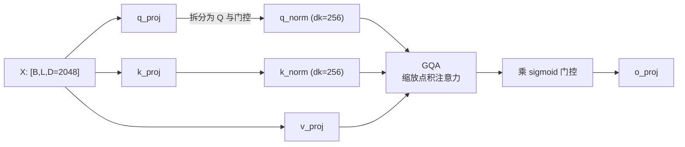
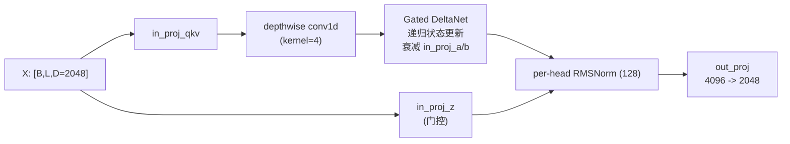
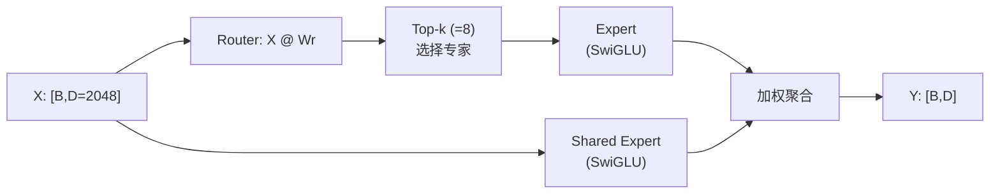

# Qwen3.6-35B-A3B 模型各层参数量计算

## 一、模型总体结构

Qwen3.6-35B-A3B 是一个 **因果语言模型 + 视觉编码器** 的多模态 MoE 模型。文本主干由 40 层组成，采用 **线性注意力 + 全注意力** 混合排布，每层后接一个稀疏混合专家（MoE）前馈网络。

文本主干的隐藏层排布为：

$$
\text{Hidden Layout} = 10 \times \Big( 3 \times (\text{Gated DeltaNet} \to \text{MoE}) \to 1 \times (\text{Gated Attention} \to \text{MoE}) \Big)
$$

即每 4 层为一个周期：前 3 层用 **Gated DeltaNet 线性注意力**，第 4 层用 **Gated Attention 全注意力**。40 层共得到 **30 层线性注意力层** 与 **10 层全注意力层**（其中第 3、7、11、…、39 层为全注意力层，其余为线性注意力层）。

整体由 40 个文本层、一个词嵌入、一个输出头、一个多 token 预测（MTP）模块以及一个视觉编码器构成，各部件的关键超参数将在其参数量计算处分别列出。

---

## 二、各基础结构的参数量

### 2.1 词嵌入与输出头

**关键超参数**

| 参数 | 值 |
|---|---:|
| `vocab_size` $V$ | 248320 |
| `hidden_size` $D$ | 2048 |
| `tie_word_embeddings` | false |

**模型结构**：词嵌入是一个 $V \times D$ 的查表矩阵。LM Head 是一个 $D \times V$ 的线性映射 $Y = XW$，不设 bias。

**参数量**：

$$
P_{\text{embed}} = V \cdot D = 248320 \times 2048 = 508{,}559{,}360
$$

由于 `tie_word_embeddings = false`，输出头将独立存在：

$$
P_{\text{lm\_head}} = D \cdot V = 2048 \times 248320 = 508{,}559{,}360
$$

两者合计为 $1,017,118,720$ 。

### 2.2 全注意力层 Gated Attention

**关键超参数**

| 参数 | 值 |
|---|---:|
| `hidden_size` $D$ | 2048 |
| `num_attention_heads` $h$ | 16 |
| `head_dim` $d_k$ | 256 |
| `num_key_value_heads` $h_{kv}$ | 2 |
| `attn_output_gate` | true |

全注意力层是 **带门控的 Grouped-Query Attention (GQA)**，在标准多头注意力的基础上做了三处工程化改动：

1. **GQA**：Query 有 $h=16$ 个头，但 Key/Value 只有 $h_{kv}=2$ 个头，显著减少 K/V 投影与 KV 缓存；
2. **输出门控**：$W^Q$ 同时输出 query 与一路门控，门控经 sigmoid 后逐元素乘到注意力输出上，因此 `q_proj` 的输出维度是 $2 \cdot h d_k$ 而非 $h d_k$；
3. **QK-Norm**：对每个头的 Q/K 做维度为 $d_k$ 的 RMSNorm（`q_norm`、`k_norm`）。

**参数量推导**：

| 张量 | 形状（out×in） | 参数量 |
|---|---|---:|
| `q_proj` | $2 h d_k \times D = 8192 \times 2048$ | 16,777,216 |
| `k_proj` | $h_{kv} d_k \times D = 512 \times 2048$ | 1,048,576 |
| `v_proj` | $h_{kv} d_k \times D = 512 \times 2048$ | 1,048,576 |
| `o_proj` | $D \times h d_k = 2048 \times 4096$ | 8,388,608 |
| `q_norm` + `k_norm` | $2 d_k = 512$ | 512 |
| **单层合计** | | **27,263,488** |

写成公式：

$$
P_{\text{full}} = \underbrace{2 h d_k D}_{\text{query+gate}} + \underbrace{2 h_{kv} d_k D}_{\text{K,V}} + \underbrace{h d_k D}_{\text{O}} + 2 d_k
= D d_k (2h + 2h_{kv} + h) + 2d_k
$$

标准多头注意力的参数量为 $\theta(4 D^2)$（即 $W^Q,W^K,W^V,W^O$ 四个方阵），而 GQA 把 $W^K,W^V$ 从 $D^2$ 压到 $D \cdot h_{kv}d_k$，加上门控只让 $W^Q$ 翻倍，依然远小于方阵。10 层合计 $272,634,880$ 。

### 2.3 线性注意力层 Gated DeltaNet

**关键超参数**

| 参数 | 值 |
|---|---:|
| `hidden_size` $D$ | 2048 |
| `linear_num_key_heads` | 16 |
| `linear_num_value_heads` | 32 |
| `linear_key/value_head_dim` | 128 |
| `linear_conv_kernel_dim` | 4 |

Gated DeltaNet 用带门控的递归状态更新替代 $L \times L$ 的显式注意力矩阵，即线性注意力。模块包含：QKV 投影、短卷积、逐头衰减参数、输出门控 $z$、per-head RMSNorm、输出投影。

- Q/K 头为 $16 \times 128$，V 头为 $32 \times 128$；
- `conv1d`：对 QKV 进行的深度可分离短卷积（kernel 尺寸为 4）；
- `in_proj_a`、`in_proj_b`、`A_log`、`dt_bias`：每个 value 头（32 个）的门控/衰减超参；
- `in_proj_z` 与 `norm`：输出门控与逐头归一化。

**参数量推导**：

| 张量 | 形状 | 参数量 |
|---|---|---:|
| `in_proj_qkv` | $8192 \times 2048$ | 16,777,216 |
| `in_proj_z`（门控） | $4096 \times 2048$ | 8,388,608 |
| `in_proj_a` | $32 \times 2048$ | 65,536 |
| `in_proj_b` | $32 \times 2048$ | 65,536 |
| `conv1d` | $8192 \times 1 \times 4$ | 32,768 |
| `A_log` + `dt_bias` | $2 \times 32$ | 64 |
| `norm` | $128$ | 128 |
| `out_proj` | $2048 \times 4096$ | 8,388,608 |
| **单层合计** | | **33,718,464** |

30 层合计 $1,011,553,920$ 。

### 2.4 混合专家 MoE

**关键超参数**

| 参数 | 值 |
|---|---:|
| `hidden_size` $D$ | 2048 |
| `num_experts` $N_e$ | 256 |
| `num_experts_per_tok` $k$ | 8 |
| `moe_intermediate_size` $d_{ff}$ | 512 |
| `shared_expert_intermediate_size` | 512 |

每层 MoE 由一个路由门 + 256 个 routed 专家 + 1 个 shared 专家组成。每个 token 经 top-8 路由，只激活 256 个专家中的 8 个，再加一路恒定激活的共享专家。

每个专家是一个 **SwiGLU FFN**：`gate_up_proj` 把 gate 与 up 两个矩阵在输出维上融合，形状 $[N_e, 2 d_{ff}, D]$ 即 $[256, 1024, 2048]$，`down_proj` 形状 $[N_e, D, d_{ff}]$ 即 $[256, 2048, 512]$。参数以“批量专家”形式堆叠为一个三维张量，即 $N_e$ 个 Expert 的批处理实现。

**参数量推导**：记专家中间维度 $d_{ff}=512$，隐藏维度 $D=2048$，专家数 $N_e=256$。

单个 SwiGLU 专家的参数：

$$
P_{\text{expert}} = \underbrace{2 D d_{ff}}_{\text{gate}+\text{up}} + \underbrace{D d_{ff}}_{\text{down}} = 3 D d_{ff} = 3 \times 2048 \times 512 = 3{,}145{,}728
$$

routed 专家总参数：

$$
P_{\text{routed}} = N_e \cdot 3 D d_{ff} = 256 \times 3{,}145{,}728 = 805{,}306{,}368
$$

即参数量约为 $\theta(N_e D d_{ff})$，SwiGLU 结构带一个常数因子 3。

| 项 | 形状/公式 | 参数量（单层） |
|---|---|---:|
| routed experts `gate_up_proj` | $256 \times 1024 \times 2048$ | 536,870,912 |
| routed experts `down_proj` | $256 \times 2048 \times 512$ | 268,435,456 |
| router `gate` | $256 \times 2048$ | 524,288 |
| shared expert `gate_proj` | $512 \times 2048$ | 1,048,576 |
| shared expert `up_proj` | $512 \times 2048$ | 1,048,576 |
| shared expert `down_proj` | $2048 \times 512$ | 1,048,576 |
| shared expert 门控 | $1 \times 2048$ | 2,048 |
| **单层 MoE 合计** | | **808,978,432** |

40 层合计 $32,359,137,280$ 。

### 2.5 归一化层

每个 Transformer 层有两个 RMSNorm（`input_layernorm` 与 `post_attention_layernorm`），每个维度 $D=2048$：

$$
P_{\text{norm per layer}} = 2D = 4096
$$

40 层合计 $163,840$；再加上最终归一化 `language_model.norm` 的 $2,048$。

---

## 三、附加模块的参数量

### 3.1 MTP 多头预测

**关键超参数**

| 参数 | 值 |
|---|---:|
| `mtp_num_hidden_layers` | 1 |
| `hidden_size` $D$ | 2048 |

Qwen3.6 训练时带 1 层 MTP（用于推测解码和加速推理）：

| 组件 | 参数量 |
|---|---:|
| `mtp.fc`（$2048 \times 4096$） | 8,388,608 |
| `pre_fc_norm_embedding`、`pre_fc_norm_hidden`、`mtp.norm` | 6,144 |
| `mtp.layers.0` 全注意力层（同为 GQA 结构） | 27,263,488 |
| `mtp.layers.0` MoE | 808,978,432 |
| `mtp.layers.0` 两个 RMSNorm | 4,096 |
| **合计** | **844,640,768** |

### 3.2 视觉编码器 Vision Encoder

**关键超参数**

| 参数 | 值 |
|---|---:|
| `depth` | 27 |
| `hidden_size` $D_v$ | 1152 |
| `intermediate_size` | 4304 |
| `patch_size` | 16 |
| `temporal_patch_size` | 2 |
| `spatial_merge_size` | 2 |

视觉塔是一个 27 层 ViT：

| 组件 | 形状/公式 | 参数量 |
|---|---|---:|
| `patch_embed.proj` | $1152 \times 3 \times 2 \times 16 \times 16$ + bias | 1,770,624 |
| `pos_embed` | $2304 \times 1152$ | 2,654,208 |
| ViT block × 27 | 见下 | 411,466,608 |
| `merger`（2×2 空间合并 + MLP） | $4608\times4608 + 2048\times4608$ + norms | 30,679,808 |
| **合计** | | **446,571,248** |

单个 ViT block（$D_v=1152$，中间维 $4304$）的参数量：

$$
P_{\text{block}} = \underbrace{3 D_v^2}_{\text{QKV}} + \underbrace{D_v^2}_{\text{proj}} + \underbrace{2 D_v \cdot 4304}_{\text{MLP}} + \underbrace{4 D_v}_{\text{2 Norm traits}} \approx 15{,}239{,}504
$$

27 个 block 合计 411,466,608。

---

## 四、参数量总计

将各模块相加：

$$
\begin{aligned}
P_{\text{total}} &= P_{\text{embed}} + P_{\text{layers}} + P_{\text{final norm}} + P_{\text{lm\_head}} + P_{\text{MTP}} + P_{\text{vision}} \\
&= 508{,}559{,}360 + 33{,}643{,}489{,}920 + 2{,}048 + 508{,}559{,}360 + 844{,}640{,}768 + 446{,}571{,}248 \\
&= 35{,}951{,}822{,}704 \approx 35.95\text{B}
\end{aligned}
$$

每个 token 只激活 8 个 routed 专家 + 1 个 shared 专家，因此**激活参数**远小于总参数。

- 单层 MoE 激活：$8 \times 3{,}145{,}728 + 3{,}147{,}776 + 524{,}288 = 28{,}837{,}888$
- 线性注意力层激活：$33{,}718{,}464 + 28{,}837{,}888 + 4096 = 62{,}560{,}448$
- 全注意力层激活：$27{,}263{,}488 + 28{,}837{,}888 + 4096 = 56{,}105{,}472$

$$
P_{\text{act}} = 30 \times 62{,}560{,}448 + 10 \times 56{,}105{,}472 + P_{\text{embed}} = 2{,}437{,}868{,}160 + 508{,}559{,}360 \approx 2.95\text{B}
$$
