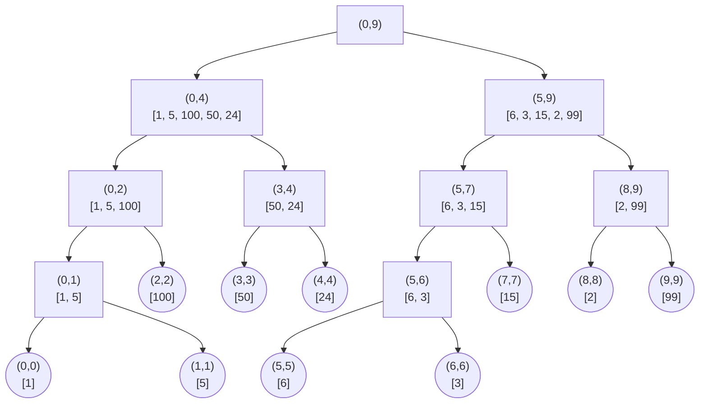
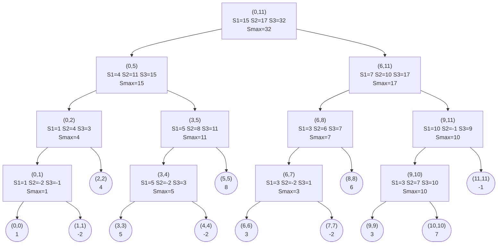
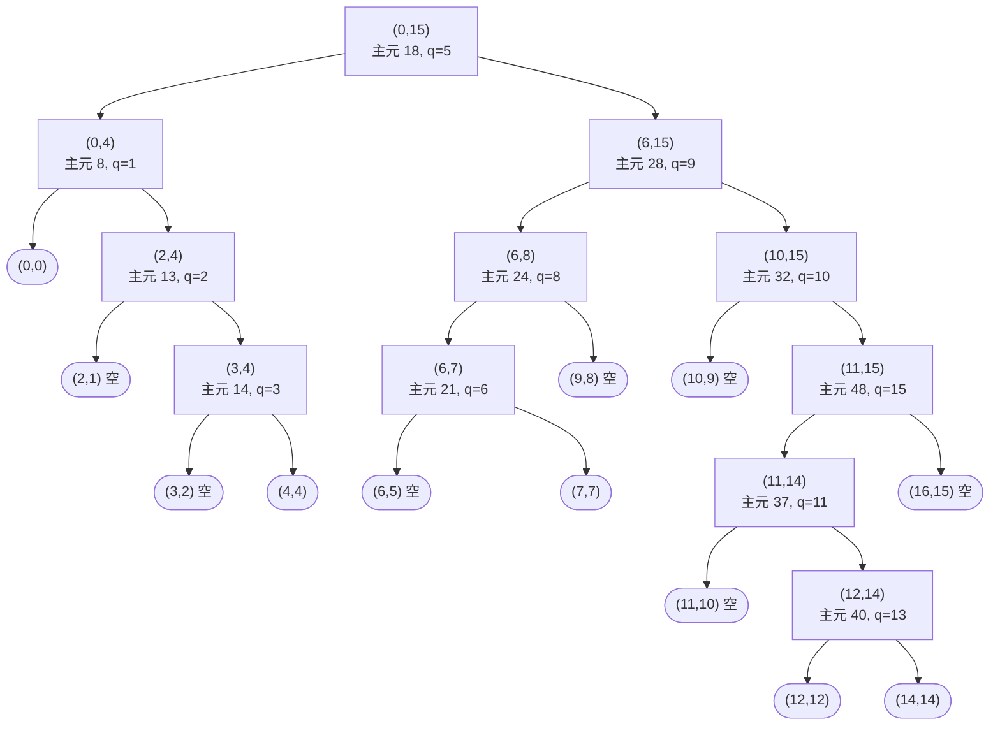

# 分治算法递归过程报告

## 一、分治法的基本框架

分治法求解问题的过程可以概括为三步：

1. **分解**：将原问题分解为若干个规模更小的子问题；
2. **解决**：递归地求解各个子问题，子问题规模足够小时直接求解并返回；
3. **合并**：将子问题的解合并为原问题的解。

本报告分析的三个算法（归并排序、最大子数组、快速排序）都遵循这一框架，但侧重点不同：归并排序与最大子数组的主要工作在“合并”，快速排序的主要工作在“分解”。

报告附件的 Python 实现代码中，也打印了一些关键步骤时的状态数据，以便观察。

## 二、归并排序的递归过程

### 2.1 算法思路

MergeSort 先把区间 $[left, right]$ 从中间一分为二，分别递归排序左右两半，再用 Merge 把两个有序子数组合并成一个有序数组。递归终止条件是区间内只剩一个元素。

伪代码（摘自课件）：

```txt
MergeSort(A, left, right)
    输入: 数组 A[1..n], 数组下标 left, right
    输出: 递增数组 A[left..right]
    if left >= right then
        return A[left..right]           // 递归终止：仅有一个元素
    end
    mid ← floor((left + right) / 2)     // 计算子问题规模
    MergeSort(A, left, mid)             // 递归求解子问题
    MergeSort(A, mid + 1, right)
    Merge(A, left, mid, right)          // 合并子问题解
    return A[left..right]

Merge(A, left, mid, right)
    A'[left..right] ← A[left..right]    // 初始化：拷贝一份
    i ← left, j ← mid + 1, k ← 0
    while i <= mid and j <= right do    // 遍历子数组，进行合并
        if A'[i] <= A'[j] then
            A[left + k] ← A'[i];  k ← k + 1, i ← i + 1
        else
            A[left + k] ← A'[j];  k ← k + 1, j ← j + 1
        end
    end
    if i <= mid then A[left + k..right] ← A'[i..mid]      // 拷贝剩余部分
    else              A[left + k..right] ← A'[j..right]
    return A[left..right]
```

### 2.2 递归过程实例

示例数组 `A = [1, 5, 100, 50, 24, 6, 3, 15, 2, 99]`。

**递归树**：

用 `(l,r)` 表示区间，用 `[a1, a2, ...]` 表示数组元素，递归树如下图所示：



**合并过程**（共 9 次）：

| 次序 | 合并调用 | 合并前 | 合并结果 |
| --- | --- | --- | --- |
| ① | Merge(0, 0, 1) | [1] 和 [5] | [1, 5] |
| ② | Merge(0, 1, 2) | [1, 5] 和 [100] | [1, 5, 100] |
| ③ | Merge(3, 3, 4) | [50] 和 [24] | [24, 50] |
| ④ | Merge(0, 2, 4) | [1, 5, 100] 和 [24, 50] | [1, 5, 24, 50, 100] |
| ⑤ | Merge(5, 5, 6) | [6] 和 [3] | [3, 6] |
| ⑥ | Merge(5, 6, 7) | [3, 6] 和 [15] | [3, 6, 15] |
| ⑦ | Merge(8, 8, 9) | [2] 和 [99] | [2, 99] |
| ⑧ | Merge(5, 7, 9) | [3, 6, 15] 和 [2, 99] | [2, 3, 6, 15, 99] |
| ⑨ | Merge(0, 4, 9) | [1, 5, 24, 50, 100] 和 [2, 3, 6, 15, 99] | [1, 2, 3, 5, 6, 15, 24, 50, 99, 100] |

具体而言，Merge(0, 4, 9) 的合并步骤如下：

| 步骤 | 比较 | 取值 | 写入 | 指针变化 |
| --- | --- | --- | --- | --- |
| 1 | 1 vs 2 | 1（左） | A[0] = 1 | i=1, k=1 |
| 2 | 5 vs 2 | 2（右） | A[1] = 2 | j=6, k=2 |
| 3 | 5 vs 3 | 3（右） | A[2] = 3 | j=7, k=3 |
| 4 | 5 vs 6 | 5（左） | A[3] = 5 | i=2, k=4 |
| 5 | 24 vs 6 | 6（右） | A[4] = 6 | j=8, k=5 |
| 6 | 24 vs 15 | 15（右） | A[5] = 15 | j=9, k=6 |
| 7 | 24 vs 99 | 24（左） | A[6] = 24 | i=3, k=7 |
| 8 | 50 vs 99 | 50（左） | A[7] = 50 | i=4, k=8 |
| 9 | 100 vs 99 | 99（右） | A[8] = 99 | j=10, k=9 |
| 10 | 右半段已取完 | 100（左段剩余） | A[9] = 100 | 循环结束 |

### 2.3 复杂度分析

设排序 $n$ 个元素的代价为 $T(n)$。分解本身是常数代价，合并需要完整扫描当前区间，代价为 $O(n)$，于是

$$T(n) = 2T\left(\frac{n}{2}\right) + O(n), \qquad T(1) = O(1)$$

递归树共有 $\log_2 n + 1$ 层，每层的总代价都是 $O(n)$，因此

$$T(n) = O(n\log n)$$

无论输入如何变化，划分总是对半进行，因此最好、平均、最坏情况都是 $O(n\log n)$。

## 三、最大子数组的递归过程

### 3.1 问题与算法思路

子数组是数组中连续的一段。最大子数组问题要求找出和最大的子数组。

分治法把区间 $[low, high]$ 以中点 $mid$ 分成两半。区间的最大子数组只可能属于三种情况之一：

- $S_1$：完全位于左半 $[low, mid]$；
- $S_2$：完全位于右半 $[mid+1, high]$；
- $S_3$：跨越中点，此时它由“以 $mid$ 结尾的左半段后缀”与“以 $mid+1$ 开始的右半段前缀”拼接而成。

前两种情况递归求解；第三种情况由 CrossingSubArray 分别向左、向右扫描求出 $S_{left}$ 与 $S_{right}$，相加得到。最后

$$S_{max} = \max\{S_1,\ S_2,\ S_3\}$$

递归终止条件是区间内只剩一个元素。

伪代码（摘自课件）：

```txt
MaxSubArray(X, low, high)
    输入: 数组 X, 数组下标 low, high
    输出: 最大子数组之和 Smax
    if low = high then                    // 递归终止条件
        return X[low]
    else
        mid ← floor((low + high) / 2)     // 拆分原问题
        S1 ← MaxSubArray(X, low, mid)     // 求解子问题
        S2 ← MaxSubArray(X, mid + 1, high)
        S3 ← CrossingSubArray(X, low, mid, high)   // 合并问题解
        Smax ← max{S1, S2, S3}
        return Smax

CrossingSubArray(X, low, mid, high)
    Sleft ← -∞; Sum ← 0
    for l ← mid downto low do             // 向左扫描，求左半最大后缀和
        Sum ← Sum + X[l]
        Sleft ← max{Sleft, Sum}
    end
    Sright ← -∞; Sum ← 0
    for r ← mid + 1 to high do            // 向右扫描，求右半最大前缀和
        Sum ← Sum + X[r]
        Sright ← max{Sright, Sum}
    end
    S3 ← Sleft + Sright
    return S3
```

### 3.2 递归过程实例

示例数组 `X = [1, -2, 4, 5, -2, 8, 3, -2, 6, 3, 7, -1]`。

**递归树**（内部结点标出 S1、S2、S3 与 $S_{max}$）：



具体而言，以根结点 CrossingSubArray(0, 5, 11)为例：

向左扫描（从 $mid = 5$ 到 0，求左半段的最大后缀和）：

| i | X[i] | 累加和 Sum | S_left |
| --- | --- | --- | --- |
| 5 | 8 | 8 | 8 |
| 4 | -2 | 6 | 8 |
| 3 | 5 | 11 | 11 |
| 2 | 4 | 15 | 15 |
| 1 | -2 | 13 | 15 |
| 0 | 1 | 14 | 15 |

得到 $S_{left} = 15$，对应左半段后缀 X[2..5] = [4, 5, -2, 8]。

向右扫描（从 6 到 $high = 11$，求右半段的最大前缀和）：

| i | X[i] | 累加和 Sum | S_right |
| --- | --- | --- | --- |
| 6 | 3 | 3 | 3 |
| 7 | -2 | 1 | 3 |
| 8 | 6 | 7 | 7 |
| 9 | 3 | 10 | 10 |
| 10 | 7 | 17 | 17 |
| 11 | -1 | 16 | 17 |

得到 $S_{right} = 17$，对应右半段前缀 X[6..10] = [3, -2, 6, 3, 7]。

于是 $S_3 = 15 + 17 = 32$，对应子数组 X[2..10] = [4, 5, -2, 8, 3, -2, 6, 3, 7]。根结点取 $S_{max} = \max\{15, 17, 32\} = 32$，这就是整个数组的最大子数组和。

### 3.3 复杂度分析

设求解长度为 $n$ 的区间的代价为 $T(n)$。每次把区间均分为两半，CrossingSubArray 虽然有两个循环，但每个元素只被访问一次，代价为 $O(n)$，于是

$$T(n) = 2T\left(\frac{n}{2}\right) + O(n), \qquad T(1) = O(1)$$

与归并排序的递归式相同，递归树每层总代价为 $O(n)$，共 $\log_2 n$ 层，因此

$$T(n) = O(n\log n)$$

## 四、快速排序的递归过程

### 4.1 算法思路

快速排序的关键是数组划分 Partition(A, p, r)：取区间最后一个元素 A[r] 作为主元 x，i 记录“小于等于主元的区域”的末尾（初始为 p - 1）。j 从 p 遍历到 r - 1，每当 A[j] <= x 就把 i 右移一位并交换 A[i] 与 A[j]；遍历结束后把主元交换到 A[i + 1]，返回划分位置 q = i + 1。划分完成后，A[p..q-1] 中的元素都不大于主元，A[q+1..r] 中的元素都大于主元，主元本身已落在最终位置上。

QuickSort 先划分，再递归排序主元两侧的子区间。由于划分已经把主元归位，而且左右子区间中元素与主元的大小关系已经确定，所以不需要额外的合并操作。

伪代码（摘自课件）：

```txt
QuickSort(A, p, r)
    输入: 数组 A, 起始位置 p, 终止位置 r
    输出: 有序数组 A
    if p < r then
        q ← Partition(A, p, r)      // 数组划分，q 为主元最终位置
        QuickSort(A, p, q - 1)      // 左右分治
        QuickSort(A, q + 1, r)
    end

Partition(A, p, r)
    x ← A[r]                        // 选取主元
    i ← p - 1
    for j ← p to r - 1 do
        if A[j] <= x then
            i ← i + 1
            exchange A[i] with A[j] // 比主元小的元素交换到前面
        end
    end
    exchange A[i + 1] with A[r]     // 主元作分界线
    q ← i + 1
    return q
```

### 4.2 递归过程实例

示例数组 `A = [17, 24, 28, 40, 13, 14, 22, 32, 40, 21, 48, 4, 47, 8, 37, 18]`。

第一次划分（主元 18，q = 5）后：

```txt
[17, 13, 14, 4, 8, 18, 22, 32, 40, 21, 48, 40, 47, 24, 37, 28]
```

**递归树**：



与归并排序不同，快速排序的递归树不是平衡的。子区间的规模由主元的取值决定，无法事先确定。

### 4.3 复杂度分析

每次划分需要线性时间 $O(n)$，设 $T(n)$ 为排序 $n$ 个元素的代价，则整体代价取决于划分是否均衡。

最好情况：每次划分后主元都恰好在中间，两个子区间规模相当，递归式为

$$T(n) = 2T\left(\frac{n}{2}\right) + O(n) = O(n\log n)$$

最坏情况：每次划分后主元都在一侧（例如输入数组已经有序，而每次都取最后一个元素作主元），递归式退化为

$$T(n) = T(n-1) + O(n) = O(n^2)$$

此时递归树退化成一条链，每层只减少一个元素。

平均情况：输入为随机排列时，主元的取值也是随机的，期望复杂度为 $O(n\log n)$。

对于最坏情况的解决方案是课件中提到的随机化快速排序。每次随机选取主元后再划分，使得最坏情况几乎不可能出现。

## 五、总结

把三个算法的递归过程放在分治法框架下对比：

| 算法 | 分解方式 | 递归调用 | 合并方式 | 时间复杂度 |
| --- | --- | --- | --- | --- |
| 归并排序 | 区间对半 | 左右两半分别排序 | 把两个有序子数组合并 | 总是 $O(n\log n)$ |
| 最大子数组 | 区间对半 | 左右两半分别求 $S_1$、$S_2$ | 求跨中点的 $S_3$，取三者最大 | 总是 $O(n\log n)$ |
| 快速排序 | 按主元划分 | 主元两侧分别排序 | 无（主元已在最终位置） | 平均 $O(n\log n)$，最坏 $O(n^2)$ |

三个算法都体现了“分解、解决、合并”的思想，但分工不同：归并排序的重点在合并，最大子数组在合并时还要额外处理跨越中点的情况，快速排序的重点则在分解。

通过上面的递归树分析可以看到，递归沿着树一路向下分解，到达规模最小的子问题后触底返回，再逐层把子问题的解组合成原问题的解。
